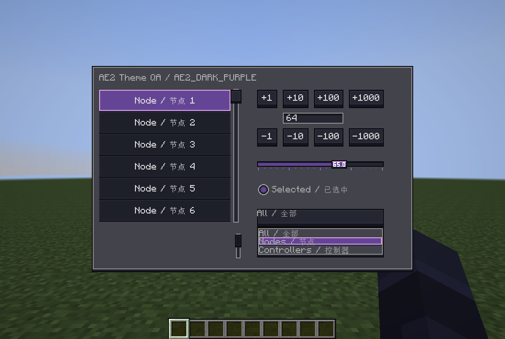

# AE2 Theme API

GTNRLib provides light, dark and purple-highlighted dark AE2 themes for ModularUI 2. Rendering helpers and themed widgets are client-side APIs. Adapted from GTNLLib through commit c1e431dbcabf33dfbba7955a28267827725c4574; source and asset records are in licenses/gtnrlib/.

## API Reference

| Type | Responsibility |
| --- | --- |
| [AE2Theme](gtnrlib/src/main/java/com/xyp/gtnrlib/gui/theme/AE2Theme.java) | Theme registration, variant lookup, drawable factories and direct drawing helpers. Includes the `Variant`, `Colors`, `ButtonText` and `Icon` types. |
| [ScreenTheme](gtnrlib/src/main/java/com/xyp/gtnrlib/gui/theme/ScreenTheme.java) | Persistable selection of the default, light, dark or purple dark panel theme. |
| [HandleScrollData](gtnrlib/src/main/java/com/xyp/gtnrlib/gui/widget/HandleScrollData.java) | Vertical scrolling with a fixed-size handle and optional row snapping. |
| [GTNRListWidget](gtnrlib/src/main/java/com/xyp/gtnrlib/gui/widget/GTNRListWidget.java) | List layout, initial scroll position and persistent scroll-bar integration. |
| [IPersistentScrollbar](gtnrlib/src/main/java/com/xyp/gtnrlib/gui/widget/IPersistentScrollbar.java) | Extension contract for scroll data that retains an inactive track. |
| [NumberEntry](gtnrlib/src/main/java/com/xyp/gtnrlib/gui/widget/NumberEntry.java) | Bounded integer input, expression parsing, step buttons and validation feedback. |

## Theme Selection

| Selection | Panel theme | Menu theme |
| --- | --- | --- |
| `ScreenTheme.DEFAULT` | Screen default (`themeId == null`) | `modularui.context_menu` |
| `ScreenTheme.AE2_LIGHT` | `gtnrlib:ae2_light` | `gtnrlib:ae2_light_menu` |
| `ScreenTheme.AE2_DARK` | `gtnrlib:ae2_dark` | `gtnrlib:ae2_dark_menu` |
| `ScreenTheme.AE2_DARK_PURPLE` | `gtnrlib:ae2_dark_purple` | `gtnrlib:ae2_dark_purple_menu` |

GTNRLib registers these themes during client initialization. Apply the selected identifier through MUI2's screen theme registration. `AE2Theme.useMenuTheme` maps named child menu panels to the matching menu theme.

The purple dark theme shares the dark palette and replaces AE2's light-blue selection with fluix purple. Custom selection drawing should read `Variant.highlight`, `highlightTop`, `highlightShadow` and `highlightText` instead of the `AE2Theme.HIGHLIGHT` constants, so it matches every variant.



## Usage Examples

### Row-Based List

```java
import com.cleanroommc.modularui.api.widget.IWidget;
import com.cleanroommc.modularui.widgets.ListWidget;
import com.xyp.gtnrlib.gui.theme.AE2Theme.Variant;
import com.xyp.gtnrlib.gui.widget.GTNRListWidget;
import com.xyp.gtnrlib.gui.widget.HandleScrollData;

HandleScrollData scrolling = new HandleScrollData(Variant.LIGHT).rows(22);
ListWidget<IWidget, ?> list = new GTNRListWidget<>().scrollDirection(scrolling)
    .size(180, 110);
```

`GTNRListWidget` reserves the scroll-bar width and draws its disabled handle when the content fits. Row snapping includes both scroll endpoints. Align content, viewport, padding and separators to the row height when partial rows must not be visible. Dragging the handle is anchored to the offset at the press, so holding the handle still never moves long lists.

### Integer Input

```java
import java.util.OptionalLong;

import com.xyp.gtnrlib.gui.theme.AE2Theme.Variant;
import com.xyp.gtnrlib.gui.widget.NumberEntry;

NumberEntry amount = new NumberEntry(Variant.LIGHT).bounds(1, 1_000_000)
    .value(64);
OptionalLong requested = amount.value();
```

`value()` returns an empty result for invalid input. `isInputValid()` checks the input; inherited `isValid()` reports the MUI2 widget lifecycle. The existing `isValueValid()` method is retained as an equivalent input check. Callbacks run only when a user changes the valid value or recovers from invalid input; programmatic `value()` and `bounds()` calls stay silent. Input accepts up to 64 characters, exact signed long literals, expressions and SI suffixes.

## Texture Attribution

Texture origins, transformations and licensing are specified in [AE2-gui-theme-NOTICE.txt](licenses/gtnrlib/AE2-gui-theme-NOTICE.txt).

## GTNR integration and verification

GTNR's client screen-theme configuration accepts `AE2_DARK_PURPLE` for the wireless frequency card, wireless power card, wildcard pattern, advanced IO bus and Useless Tools. Existing defaults remain unchanged.

Run `./gradlew.bat :gtnrlib:checkLibraryContracts` for drag anchoring, endpoint, row snapping and theme JSON reload regression checks. Run `./gradlew.bat -I gtnrlib/scripts/ae2-theme-qa.init.gradle :gtnrlib:runClient25 --no-configuration-cache` for isolated client checks. The fixture uses a transparent, click-through, silent background window and verifies all four screen themes, thousand-row dragging, empty lists, long-number bounds, callbacks and dropdown hover/selection. Screenshots and results are written to `gtnrlib/build/ae2-theme-qa/results`. It drives in-game widget APIs rather than physical input.
