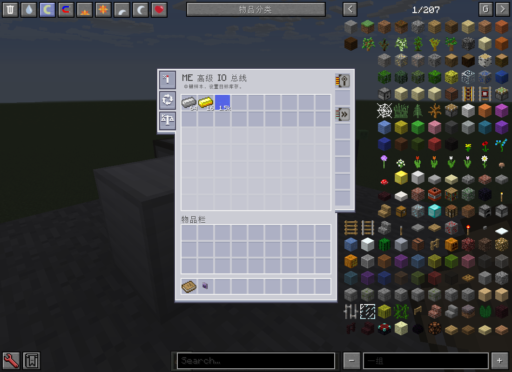
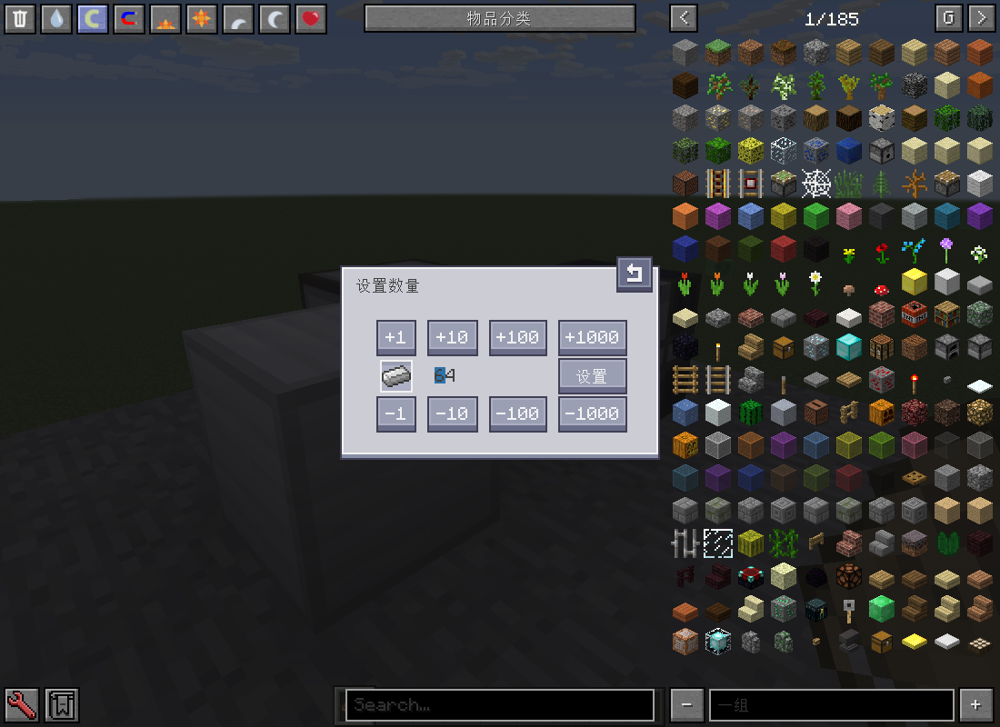
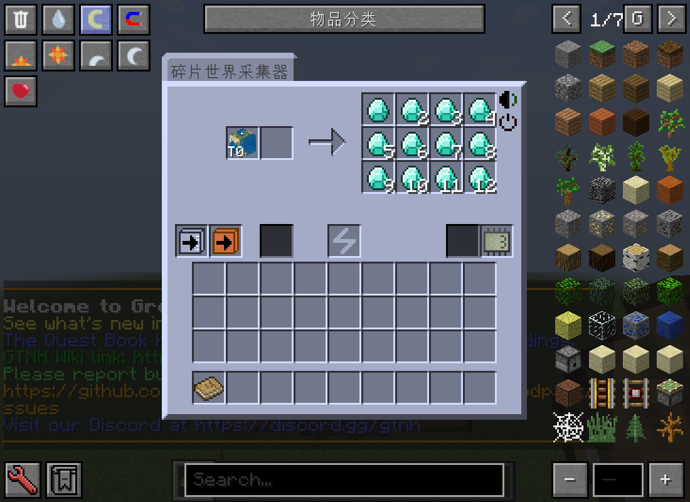
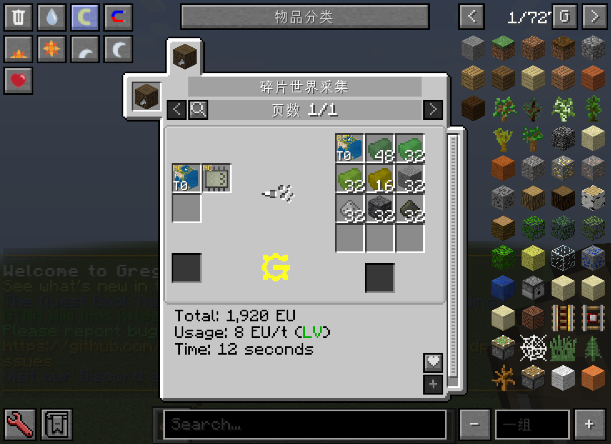
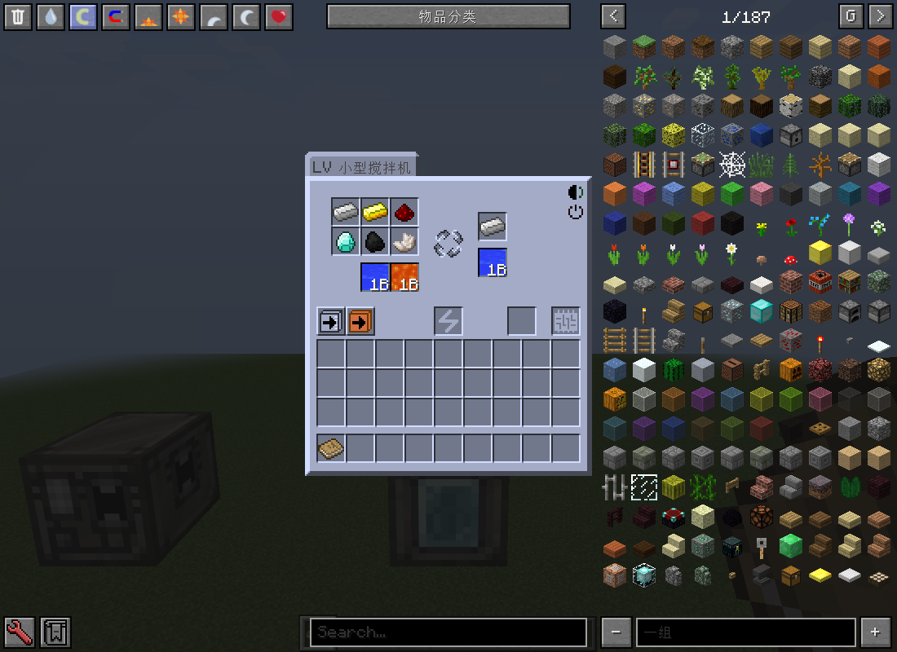
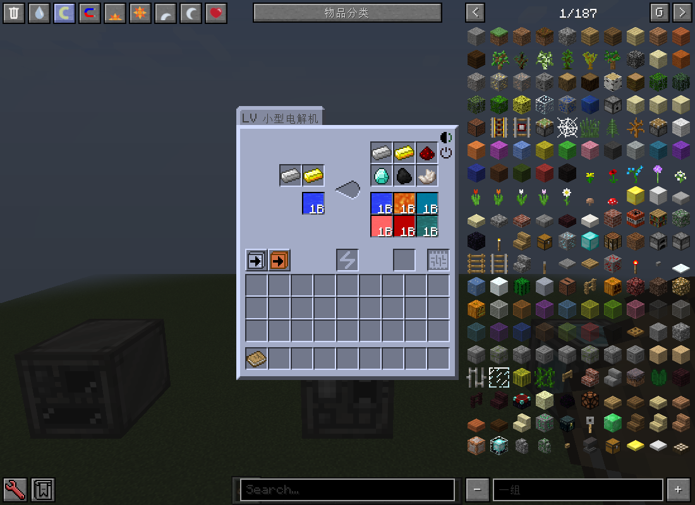
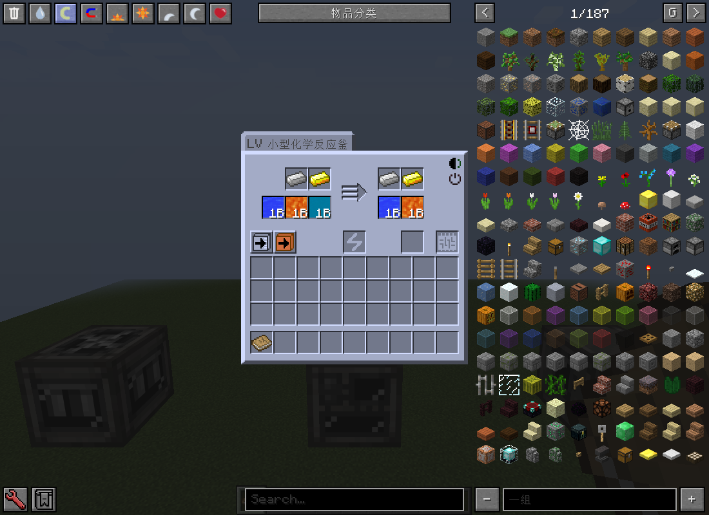
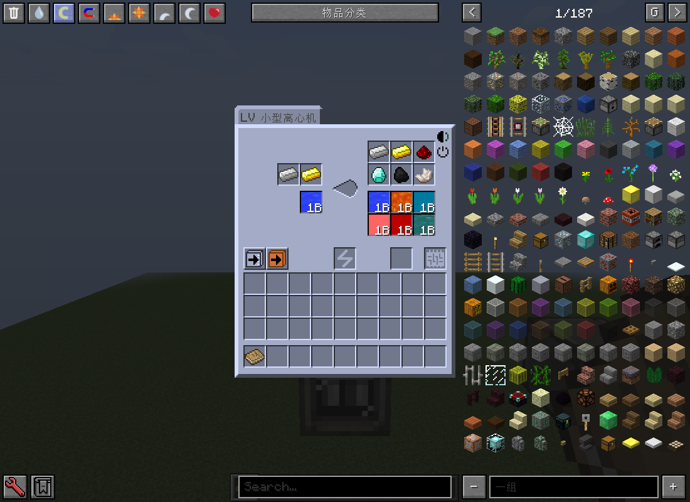
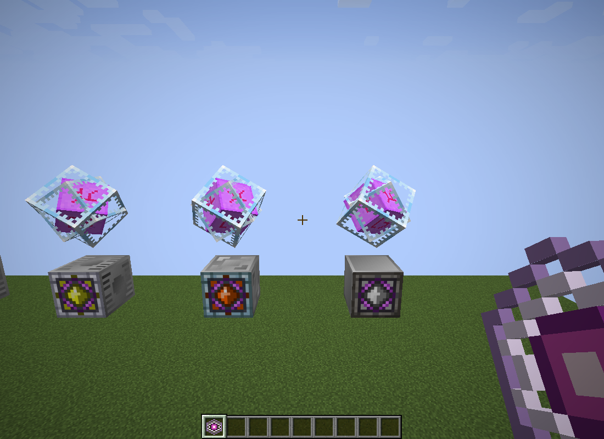

# GT-Never-Reset

面向 Minecraft 1.7.10 / Forge 的 GT New Horizons 附属模组。

## 📥 下载与兼容性

| GTNH 版本 | 模组版本 | 现状 | 下载 |
| --- | --- | --- | --- |
| `2.9.0-RC-2`（开发基准） | `0.1.1` | 已发布 |  |

可在 [0.1.1 发行页](https://github.com/ikkkkkkkuuu/GT-Never-Reset/releases/tag/0.1.1) 下载正式模组文件 `gtneverreset-0.1.1.jar`。构建状态与日志可在 [Actions](https://github.com/ikkkkkkkuuu/GT-Never-Reset/actions) 查看。

开发环境使用 Minecraft `1.7.10`、Forge `10.13.4.1614`，以 GTNH `2.9.0-RC-2` 的依赖清单为基准；其他 GTNH 版本的兼容性尚待验证。

## 🧩 功能介绍

### ME 高级 IO 总线

同时管理相邻机器的物品与流体库存：从 ME 网络补足指定原料，并将未标记的资源送回 ME，适合持续备料与自动回收。

- **目标库存**：为每种物品或流体分别设置目标数量，库存不足时自动补货；可开启超量回收，将超出目标的部分送回 ME。
- **样本槽位**：默认 18 个，每张容量卡增加 9 个，最多扩展至 63 个。物品与流体共用样本槽。
- **传输升级**：基础吞吐量等同一张超级光速卡，提供 8 个升级槽，支持加速卡、容量卡与红石卡。
- **调度与控制**：支持顺序、轮询和随机调度；安装红石卡后可设置有信号或无信号时运行。
- **连接规则**：传输遵循机器连接面的物品与流体访问限制。

将总线安装在朝向目标机器的 ME 线缆面上，接通网络后右键打开界面。放入物品或流体样本进行标记，再中键点击样本设置目标数量；左侧按钮可切换调度方式与超量回收。

主界面：配置物品与流体样本，右侧安装升级卡，左侧调整工作方式。

目标库存设置：中键点击样本后输入所需数量，确认后生效。

### 碎片世界采集器

使用维度展示方块与电路选择采集资源，可在任意维度运行，持续产出对应配方的矿石、岩石、流体及部分特殊资源。

- **维度选择**：维度展示方块用于指定资源来源，采集时不会被消耗，无需将机器放到对应维度。
- **配方选择**：通过电路编号切换采集目标，具体原料、产物、概率与耗时可在 NEI 中查询。
- **流体采集**：需要配方指定的钻头，不同材质对应不同采集量，钻头有概率被消耗。
- **运行耗电**：基础耗电为 8 EU/t，处理时间随所选配方变化。
- **产物输出**：提供 12 个物品输出槽，支持物品与流体自动输出；可在界面左下角分别切换，`Shift + 点击` 输出按钮选择输出方向。

先在 NEI 中查看目标配方，放入对应的维度展示方块及所需原料，设置电路编号后接通电源。流体采集时额外放入所需钻头，并为产物准备好输出空间。

主界面示例：左侧放入采集所需物品，右侧为 12 个物品输出槽，下方可设置电路和自动输出。

NEI 配方示例：查看维度展示方块、电路编号、产物概率、耗电与处理时间。

### GTM 风格小型机器

提供小型搅拌机、小型电解机、小型化学反应釜和小型离心机，均覆盖 LV 至 UV，共 32 台机器。采用 GTM 风格的外观与独立流体槽，直接通过流体管道安排原料和产物。

- **直接处理流体**：将对应 GTNH 单方块机器的可转换配方适配为直接流体输入输出，保留原配方的电压、耗时、概率与环境要求。
- **制作方式**：在组装机中使用同档原版机器、2 个同档电动泵、144 L 熔融锡和 24 号配置电路进行升级。
- **自动输出**：物品与流体自动输出可分别开关，使用同一个输出面；`Shift + 点击` 自动输出按钮可选择输出方向。

| 机器 | 物品输入 / 输出槽 | 流体输入 / 输出槽 | 单个流体槽容量 |
| --- | --- | --- | --- |
| 小型搅拌机 | 6 / 1 | 2 / 1 | LV：8,000 L；MV：12,000 L；HV–UV：16,000 L |
| 小型电解机 | 2 / 6 | 1 / 6 | LV：32,000 L；MV：48,000 L；HV–UV：64,000 L |
| 小型化学反应釜 | 2 / 2 | 3 / 2 | 各档均为 16,000 L |
| 小型离心机 | 2 / 6 | 1 / 6 | LV：32,000 L；MV：48,000 L；HV–UV：64,000 L |

以下截图展示各机型的界面与槽位布局，槽内物品和流体为展示样例，实际配方可在 NEI 中查询。

#### 小型搅拌机

用于混合物品与流体原料，提供两个独立的流体输入槽，方便同时接入不同流体。

#### 小型电解机

用于电解分解原料，最多提供六个物品输出槽和六个流体输出槽，多种流体产物可分别存放。

#### 小型化学反应釜

用于执行小型化学反应配方，提供三个流体输入槽和两个流体输出槽，减少多流体配方中的单元周转。

#### 小型离心机

用于离心分离物品与流体原料，提供六个物品输出槽和六个流体输出槽，便于接出多种分离产物。

### 末影水晶发电机

游戏内名称为“末晶谐振器”，提供 LV 至 MAX 共 14 档。利用正上方的稳定末影水晶持续发电，无需补充燃料，适合为 GT 无线电网提供持续供能。

- **持续发电**：运行时不消耗稳定末影水晶，也不产生污染；仅识别本模组的稳定末影水晶。
- **无线供电**：每 20 tick 将产生的 EU 存入机主所属的 GT 无线电网，无需连接电缆。
- **发电功率**：LV 为额定电压的 32 倍，即 1,024 EU/t；其余档位为额定电压的 128 倍，具体数值可查看机器提示。
- **水晶回收**：稳定末影水晶不会爆炸或点燃方块，生存模式下打破后可回收。

稳定末影水晶由 7 个玻璃、1 个末影之眼和 1 个恶魂之泪合成，发电机在组装机中制作，具体配方可在 NEI 中查询。放置机器后，在其上方留出两格空气，手持稳定末影水晶右键机器顶面即可开始发电；移除水晶后停止发电。

实机外观：稳定末影水晶悬浮在末晶谐振器上方，保留旋转与浮动动画。

## 📜 制作人员与署名

本项目作者：[xyp](https://github.com/ikkkkkkkuuu)。感谢以下开源项目及贡献者提供的代码、资源和实现参考：

| 项目 | 作者 / 贡献者 | 许可 |
| --- | --- | --- |
| [GT-Not-Good](https://github.com/ikkkkkkkuuu/GT-Not-Good) | GT-Not-Good 贡献者 | [MIT](https://github.com/ikkkkkkkuuu/GT-Never-Reset/blob/0.1.1/src/main/resources/META-INF/compact-ae-port/GT-Not-Good-MIT.txt)，第三方派生部分保留原许可 |
| [GT-Not-Leisure](https://github.com/ABKQPO/GT-Not-Leisure) | GT-Not-Leisure 贡献者；自动提示相关贡献者 LineBroke | [LGPL-3.0-only](https://github.com/ikkkkkkkuuu/GT-Never-Reset/blob/0.1.1/src/main/resources/META-INF/compact-ae-port/GT-Not-Leisure-LGPL-3.0.txt) |
| [GregTech / GT5-Unofficial](https://github.com/GTNewHorizons/GT5-Unofficial) | GTNewHorizons、GregTech / GT++ 贡献者 | [LGPL-3.0 / LGPL-3.0-or-later](https://github.com/ikkkkkkkuuu/GT-Never-Reset/blob/0.1.1/src/main/resources/META-INF/super-storage-input-port/NOTICE.md)，以对应文件声明为准 |
| [Twist Space Technology](https://github.com/Nxer/Twist-Space-Technology-Mod) | Nxer 及贡献者 | [GPL-3.0-only](https://github.com/ikkkkkkkuuu/GT-Never-Reset/blob/0.1.1/src/main/resources/META-INF/multiblock-base-port/GPL-3.0.txt) |
| [Applied Energistics 2](https://github.com/AppliedEnergistics/Applied-Energistics-2) / [GTNH 分支](https://github.com/GTNewHorizons/Applied-Energistics-2-Unofficial) | AlgorithmX2、TeamAppliedEnergistics、Ridanisaurus Rid 及贡献者 | 代码：[LGPL-3.0-or-later](https://github.com/ikkkkkkkuuu/GT-Never-Reset/blob/0.1.1/src/main/resources/META-INF/advancedio-port/NOTICE.md)；视觉素材：[CC BY-NC-SA 3.0](https://github.com/ikkkkkkkuuu/GT-Never-Reset/blob/0.1.1/src/main/resources/META-INF/wireless-terminal-port/AE2-CC-BY-NC-SA-3.0.txt)；部分旧版 GUI 贴图：[LGPL-3.0](https://github.com/ikkkkkkkuuu/GT-Never-Reset/blob/0.1.1/src/main/resources/META-INF/wildcard-pattern-port/NOTICE.md) |
| [AdvancedAE](https://github.com/pedroksl/AdvancedAE) | pedroksl 及贡献者 | [LGPL-3.0](https://github.com/ikkkkkkkuuu/GT-Never-Reset/blob/0.1.1/src/main/resources/META-INF/advancedio-port/LICENSE-LGPL-3.0.txt) |
| [AE2AddonLib](https://github.com/pedroksl/AE2AddonLib) | pedroksl 及贡献者 | [GPL-3.0-only](https://github.com/ikkkkkkkuuu/GT-Never-Reset/blob/0.1.1/src/main/resources/META-INF/advancedio-port/AE2AddonLib-LICENSE.txt) |
| [Flux Networks](https://github.com/SonarSonic/Flux-Networks) | Ollie Lansdell / SonarSonic、BloCamLimb 及贡献者 | 代码与方块资源：[MIT](https://github.com/ikkkkkkkuuu/GT-Never-Reset/blob/0.1.1/src/main/resources/META-INF/licenses/Flux-Networks-MIT.txt)；GUI 设计与资源：[CC BY-NC-SA 4.0](https://github.com/ikkkkkkkuuu/GT-Never-Reset/blob/0.1.1/src/main/resources/META-INF/licenses/Flux-Networks-GUI-CC-BY-NC-SA-4.0.txt) |
| [Modernity GTNH UI](https://github.com/ModernityGTNH/Modernity-GTNH-UI) / [Dark UI](https://github.com/ModernityGTNH/Modernity-GTNH-Dark-UI) | ModernityGTNH 贡献者 | [CC BY-NC-SA 4.0](https://github.com/ikkkkkkkuuu/GT-Never-Reset/blob/0.1.1/src/main/resources/META-INF/wireless-terminal-port/Modernity-CC-BY-NC-SA-4.0.txt) |
| [AE2 Lightning Tech Reborn](https://github.com/AE2-Lightning-Tech-Reborn/AE2-Lightning-Tech-Reborn) 无线频率卡贴图 | MOAKIEE、CystrySU、gjmhmm8、\_leng、TedXenon、MHanHanBing 等贡献者 | [CC BY-NC-SA 3.0](https://github.com/ikkkkkkkuuu/GT-Never-Reset/blob/0.1.1/src/main/resources/META-INF/wireless-frequency-card/LICENSE-CC-BY-NC-SA-3.0.txt) |
| [GTNH Beyond the Stars](https://github.com/v3rysp3d/GTNH-Beyond-the-Stars) 贴图 | V3rySp3d | [MIT](https://github.com/ikkkkkkkuuu/GT-Never-Reset/blob/0.1.1/src/main/resources/META-INF/vault-port/LICENSE-Beyond-the-Stars-MIT.txt) |
| Wildcard-Pattern | LeoDreamer | [MIT](https://github.com/ikkkkkkkuuu/GT-Never-Reset/blob/0.1.1/src/main/resources/META-INF/wildcard-pattern-port/Wildcard-Pattern-MIT.txt) |
| LDLib | LDLib 贡献者 | [LGPL-3.0](https://github.com/ikkkkkkkuuu/GT-Never-Reset/blob/0.1.1/src/main/resources/META-INF/wildcard-pattern-port/LDLib-LGPL-3.0.txt) |
| [GregTechCEu / GregTech Modern](https://github.com/GregTechCEu/GregTech-Modern) 资源 | GregTechCEu 贡献者 | [LGPL-3.0](https://github.com/ikkkkkkkuuu/GT-Never-Reset/blob/0.1.1/src/main/resources/META-INF/wildcard-pattern-port/GTCEu-LGPL-3.0.txt) |
| GTL-Enhancedcore 大型熔炉 | S_Fast | [LGPL-3.0](https://github.com/ikkkkkkkuuu/GT-Never-Reset/blob/0.1.1/src/main/resources/META-INF/large-furnace-port/LICENSE-LGPL-3.0.txt) |

本项目原创部分采用 [MIT](LICENSE) 许可；上表所列第三方代码和资源保留各自的许可。

来源版本和文件清单见 [`src/main/resources/META-INF`](src/main/resources/META-INF)。翻译构建逻辑及其来源说明见 [`addon.gradle`](addon.gradle)。
