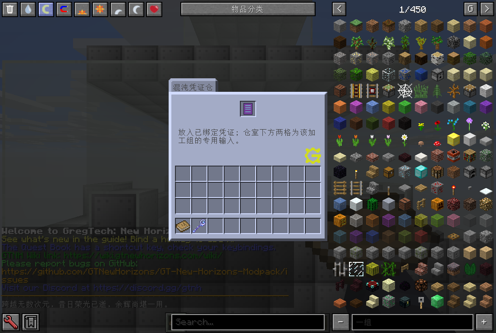

# 混沌中瓶

GTNR 独立实现，参考 TST 瓶中混沌的凭证、结构模组、多加工组与内部产线机制。开发和验证位于 `codex/chaos-within-bottle`，PR #93；主目录不承载开发修改。

## 参考版本与适配范围

上游核对至 [`a4b6e17bb02802edfd5c449248e20881faee25b8`](https://github.com/Nxer/Twist-Space-Technology-Mod/tree/a4b6e17bb02802edfd5c449248e20881faee25b8)。相关功能见 [PR #1361](https://github.com/Nxer/Twist-Space-Technology-Mod/pull/1361)、[PR #1403](https://github.com/Nxer/Twist-Space-Technology-Mod/pull/1403)、[PR #1417](https://github.com/Nxer/Twist-Space-Technology-Mod/pull/1417)。本实现没有复制 TST 源码、结构或贴图，也不要求安装 TST。

| 参考能力 | GTNR 实现 |
| --- | --- |
| 生产凭证 | 空白凭证在主机工作区绑定预设或 AE 链；执行时从当前配方注册表解析签名 |
| 结构模组 | 消耗空模组、支持的 GT 单方块机器和 8 个坚固钢外壳封装；机器类型与等级决定配方池和电压上限 |
| 多加工组 | 8 组独立凭证、步骤、物料缓存和待交付产物；轮转分配整机功率 |
| 内部生产链 | 按步骤执行，优先使用组内中间物料，再使用共享或本组输入；最终输出剩余主产物及副产物 |
| 预设链 | 铁、铜、金、锡、镍、铅的四步矿物精炼链，直接选用当前整合环境中的真实配方 |
| AE 自定义链 | 最多 32 个加工样板；从左到右、从上到下执行；样板堆叠数为步骤重复次数 |
| 上游专属内容 | TST 专属材料、完整上游预设目录、多方块结构封装、原型机转换和无线供能未移植；它们不被伪造为免费或简化配方 |

这是完整运行机制的 GTNR 初版，配方支持范围受下面的能力检查约束，并非全部 TST 内容的一比一移植。

## 使用与平衡

主机通过 UV 装配机合成；凭证仓、空凭证与空结构模组使用 ZPM 装配机配方。配方在现有 `AssemblerRecipes` 中注册，NEI 可查询。凭证注入和模组封装另有只用于 NEI 展示的配方池；普通机器不能执行这些展示配方。

1. 建造 11 × 13 × 11 的瓶形结构，控制器在资源坐标 `(5, 8, 0)`。使用结构投影查看实际放置方向。
2. 主机至少需要输入总线、输出总线、输出仓、能源输入以及一个维护仓。玻璃等级不能低于最高能源仓等级。
3. 八个固定凭证位置可用坚固钢外壳占位。装入凭证仓后启用对应组；凭证仓下方两个位置可以安装该组的输入总线或输入仓。
4. 工作区依次提供空凭证输入、凭证输出、空模组、待封装机器、外壳、模组输出槽。点击预设名称切换路线，再注入；或放入 AE 加工样板并点击“注入 AE”。样板不会消耗。
5. 安装链中各配方池对应的模组，最多 16 个。所需电压同时受到模组和整机电压限制，每组每次执行一个原生配方，按 GT 普通超频规则处理。
6. 供应原料并运行。悬浮加工组状态查看当前步骤需求及容量。每组基础容量为 1,000,000 单位，玻璃高于 HV 后每级翻倍，上限倍率为 2^20；物品数与流体升数合计占用容量，最多 256 种物料。

精炼路线为：矿石 → 粉碎矿石 → 洗净矿石 → 离心矿石 → 粉。每步重复次数按上一步主产物数量计算，保留原生配方的水耗、能耗、加工时间和随机副产物。

## 配方授权与运行边界

`ChaosChain.SUPPORTED_MAPS` 列出支持的配方池，包括粉碎、洗矿、热力离心及若干常规加工和无单元配方池。模组仅提供其原机器所声明的配方池；不能拿普通机器模组冒充其他配方池或更高电压。

AE 样板必须是加工样板，并且输入输出数量与真实配方一致。`PatternRecipeMap` 的配方池标记可消除跨配方池多义匹配。同一池中完全等价的重复注册视为同一配方；不同配方或不同池的多义匹配会拒绝。配方签名保存逐项输入输出、工具、概率、NBT 匹配方式、耗时与能耗，凭证不提供任意产物的执行权限。

只接受普通可缓存的 `GTRecipe`，拒绝特殊配方子类、非空特殊槽、特殊值、附加 metadata 和需要空输出的配方。需要温度、线圈、洁净室、研究等条件的配方暂不执行。AE 链还拒绝概率消耗、随机物品或流体输出；预设允许原生随机副产物。

物料事务复用现有 `RecipeThreadProcessingLogic`、`RecipeThreadInputPreflight` 与 `RecipeThreadOutputs`：先在副本上试算、检查缓存与可抽取输入，再提交；交付失败保留剩余产物。共享 ME 库存抽取仍遵循现有 GTNR 预检及 GT 仓室事务约定。双输入样板仓不会作为专用输入使用；这里的 AE 链由工作区样板定义。

## 持久化与暂停

- 各组分别保存凭证快照、中间缓存、当前步骤和重复次数、剩余时间、能耗、已投入工序的待完成产物，以及尚未交付的输出。
- 断电和暂停不重扣原料；结构失效由原生 GT 生命周期停机。恢复结构和供电后可继续。
- 导出请求等待当前工序完成，随后停组并交付缓存，不再执行后续步骤。已暂停的工序需要恢复运行才会完成。
- 输出堵塞保留未交付部分；重新加载不会再发已交付部分。
- 有任务时不能取出已装模组或所属凭证，可补装缺少的模组。绑定后缺料的组也算有任务；导出可以取消这种等待。
- 机器掉落物保存工作区和各组状态，重新放置后恢复。配方更新导致旧签名失效时停止该组，可使用导出回收中间物料。

## 职责与资源

| 职责 | 位置（相对 `com.xyp.gtneverreset`） |
| --- | --- |
| 主机、凭证仓 | `common.machine.multiblock.BottleInChaos`、`common.machine.hatch.ChaosCredentialHatch` |
| 两种物品 | `common.item.items` |
| 生产链、预设、物料账本、组状态 | `common.crafting.chaos` |
| AE 配方匹配 | `common.me.ChaosPatternCompiler` |
| 主机与仓室 GUI | `common.gui.modularui.multiblock`、`common.gui.modularui.hatch` |
| 配方与注册 | 现有 loader、机器 loader、`AssemblerRecipes`、两个按目标配方池划分的展示配方类 |

结构为 `assets/gtneverreset/multiblock/bottle_in_chaos.mbs`，MBS1 二进制。Java 只保留元素映射与偏移；专属中英文提示使用 tooltip Markdown，其他语言键由 `#tr` 生成。

## 验证

构建检查：`spotlessApply`、`spotlessCheck`、`compileJava`、`processResources`、`checkTranslationFormatValidator`、`git diff --check`。

运行夹具：

```powershell
.\gradlew.bat -I src/qa/resources/bottle-in-chaos-qa.init.gradle :runClient17 --no-configuration-cache
```

夹具使用独立的 `build/bottle-in-chaos-qa/run`，后台透明、点击穿透、静音且不显示任务栏按钮。无需电脑操控或修改正常游戏实例。结果、报告和截图在该目录；测试失败使 Gradle 任务失败。

覆盖真实预设解析、AE 配方与非法输出、跨池歧义、概率流体输出、长整数缓存、二进制结构、封装和注入成本、共享库存争用、专用输入隔离、缺料、容量不足、断电、结构损坏、存读档、输出堵塞、完成当前工序后导出、机器掉落物保存，以及主机 GUI 操作同步和凭证仓显示。

2026-11-15：42 项运行断言通过，主机界面、凭证仓界面和结构截图已人工核对。记录见 [运行报告](images/bottle-in-chaos/report.txt)。



