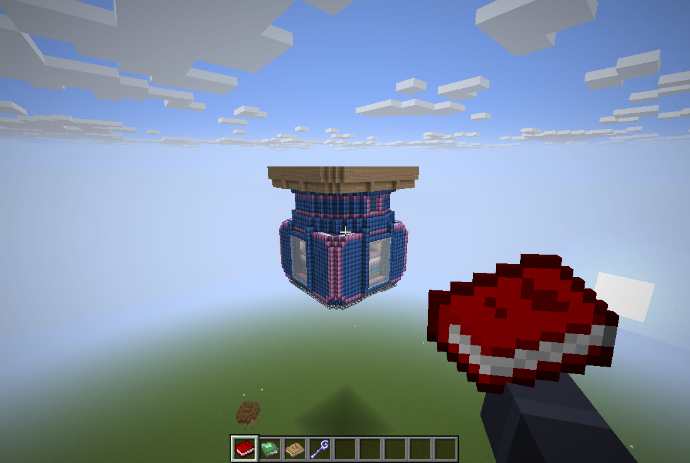
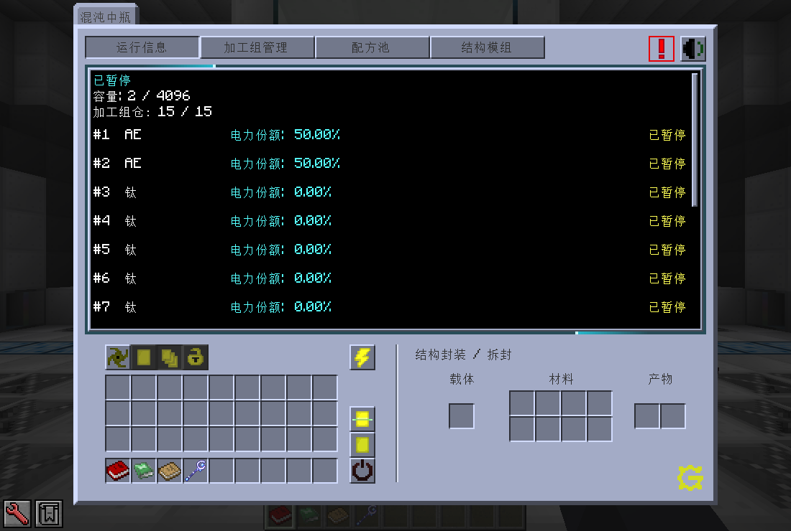
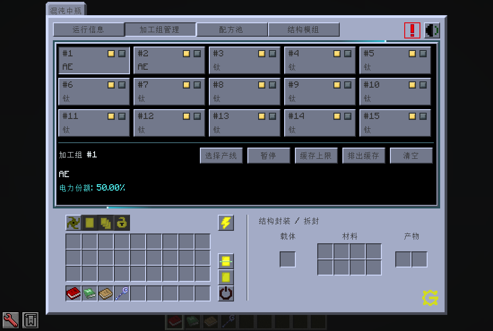
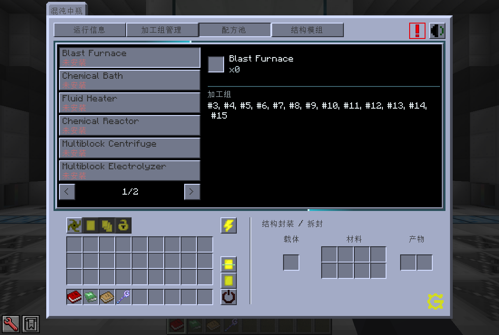
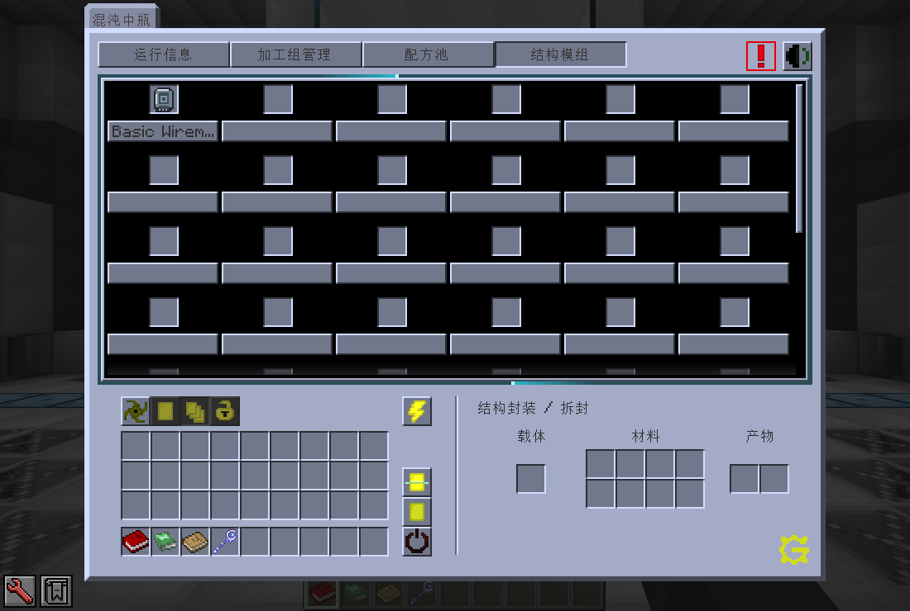
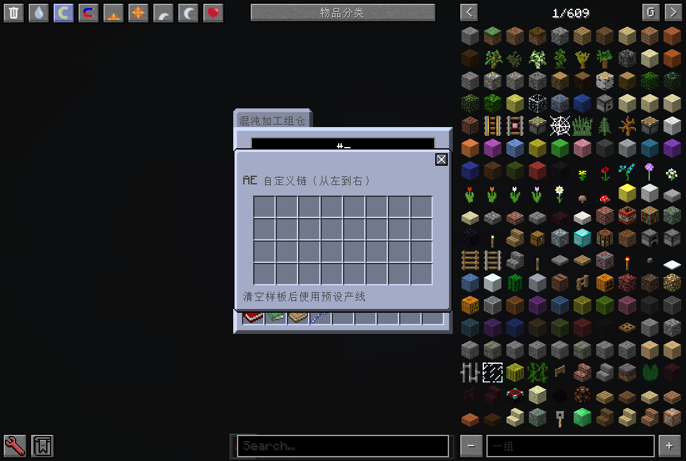
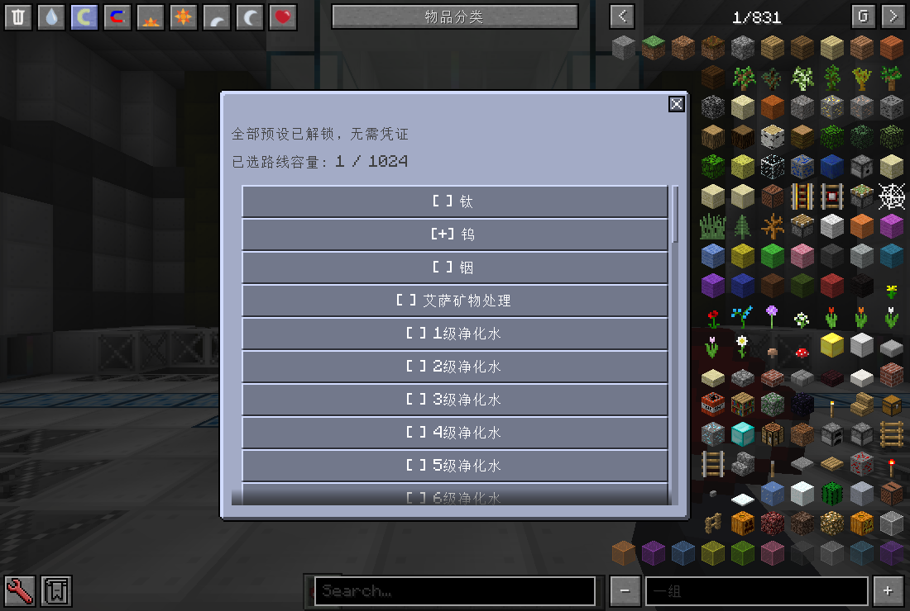

# 混沌中瓶

参考 TST 瓶中混沌提交 [`a4b6e17bb02802edfd5c449248e20881faee25b8`](https://github.com/Nxer/Twist-Space-Technology-Mod/tree/a4b6e17bb02802edfd5c449248e20881faee25b8)，在 GTNR 中独立运行，不要求安装 TST。开发位于 `codex/chaos-within-bottle`，对应草稿 PR #93。

## 本轮明确的适配

- 不制作、消耗或安装实体凭证。加工组直接选择预设路线；旧凭证注册 ID 仅为存档兼容保留，并从创造栏隐藏。
- 保留原版结构、四页 GUI、结构封装、多加工组、内部物料合并、缓存、能量分配与来源机器参数。
- 加工组另提供 32 个 AE 加工样板槽。放入样板启用自定义链，清空后恢复预设；每组单独编译，不能修改其他组的预设。
- 高阶结构件允许采用 GTNH 原生材料替代 TST 专属依赖。结构提供的能力沿用原设计；制造配方优先保留研究、电压和加工时长，跨机器配方池的调整在下文单独列出。

## 结构和界面

标准结构为 29 × 41 × 29，使用 MBS1 二进制形状资源。控制器偏移为 14、35、12，另保留原型机及扩展结构。

原版四页界面分别为运行、加工组、配方池、结构模组；下方为结构封装和拆封工作区。加工组提供路线选择、缓存设置、执行开关、缓存导出与产物优先设置。无凭证版增加直接选线窗口和 AE 样板窗口。

并行模块等级控制 1 至 15 个加工组和 6 至 48 个结构模组槽。四个独立容量区支持留空或同级方块填满，每区 64 个方块；顶级容量合计 4096。升级玻璃、能量矩阵与稳定场发生器使用同一成型检查确定整机等级。

## 加工与原生配方

预设来自上游完整目录，包括钛、钨、铟、铂、镧系、纳米提取、硅岩与燃料、聚变、下界合金、研磨、炫彩材料、纯水、凯夫拉、拉多、生命材料、晶体循环、超立方体、高阶材料、奇异物质、蜂产品和试剂支线。

预设在加载完成后解析实际注册的 GTNH 配方，再编译为内部物料流与计时数据；缺失必需源配方时明确禁用目录并记录原因，不生成虚构输入或免费产物。开发环境必须启用 GTNH 正常配方脚本及其前置，不能以精简模组列表代表整合包。

结构模组包含实际控制器、完整结构材料、升级选择和数量。封装与拆封使用同一材料清单，运行时不扫描世界结构；ME 存储元件作为封装材料输入时遵循模拟和提交事务。

AE 链以真实注册配方校验输入输出、数量、NBT、耗时与功率，拒绝伪造产物和歧义配方。当前 AE 编译器仅接受可安全缓存的确定性配方；预设的特殊机器条件通过原版专属处理器实现。

## 独立来源模组

29 类 TST 来源机器的结构方案直接内置于 GTNR。封装时支付对应原生 GTNH 控制器和原版结构材料清单，产物记录独立的 `gtnr.chaos.source.*` 身份；运行时使用被选来源的并行、功率、速度、玻璃／线圈等级及升级规则。控制器作为替代制造材料，不会把来源参数降为该原生控制器的参数。

这是混沌中瓶内部的来源模组，不会额外注册 29 台可放置的 TST 机器。46 个上游结构分片转换为 MBS1，保留标准、原型和重复结构的分片定义；有重复层的结构不以 NEI 展示的 64 层为制造上限。NEI 中可选择层数、玻璃、线圈及专属升级，封装和拆封用同一份实付材料记录。

来源包括晶体无限者、神圣分离者、强能化学扭曲装置、磁畴构筑机、磁驱压力成型机、磁力搅拌机、分子解构器、物质形态转换器、光量子掌控者、空间缩放仪、进阶裂化机、球状闪电、生物圈 III、人类能源设施核心、真空干燥炉、赫菲斯托斯工坊、不可视之触、工业电磁离析机、加工中心、奇迹之门、高能态热对流器、家用破壁机、拾荒者、熯焱高炉、热能饕餮、真空抽滤器和三个模块化原型来源。配方池支持遵循瓶中混沌原版的来源策略；例如球状闪电仅接入原版允许的 MK-I 电弧炉模式。

多用途核心保留原版 IV、LuV、ZPM、UV 四档，以对应九台小机器合成，破坏时返还这九台机器。原本依赖 TST 的结构外壳使用同类原生结构件替代。

## 原生材料替代

| TST 专属输入 | GTNR 配方采用的 GTNH 输入 |
| --- | --- |
| 完美兰波顿水晶 | 兰波顿能量球簇 |
| 能量波动自谐器 | 三级场操纵器 |
| 终极能量流电路 | YPIC 晶圆 |
| 空间扭曲器 | 时空连续体撕裂器 |
| 临界光子（稳定场配方） | 特殊激光透镜 |
| 粒子陷阱时空护盾 | 二级超材料屏蔽件 |
| 湮灭约束器 | 四级共振腔 |
| 浓缩 UU 物质 | 原生 UU 物质；凝聚装配阶段使用时空纠缠凝聚物 |
| Axonium 超致密板 | 永恒超致密板 |

时空凝聚物数量向上取整至原生 144 mB 单位。UXV 光子升级在空间装配模块制作，将三种超导基液替为相应等级的十六倍超导线，适配原生配方池四流体槽限制。

临界光子原本依赖 TST 戴森球系统，独立版改为 UV 激光雕刻机：量子之星和不消耗的特殊激光透镜，60 秒产出 64 个。引力透镜改在原生空间装配模块制造，以时空连续体撕裂器替代空间扭曲器，保留 UIV、1 秒、两件保证输出及四件 50% 概率输出。其余专属材料替代还包括高功率线圈中的原生激光管、四级共振腔、兰波顿能量球簇；炎狱升级芯片研究目标改为原生火山熔炉。以上为获准的独立适配，不代表 TST 原始制造成本完全相同。

## 验证状态

2026-11-15 的独立客户端夹具通过 629 项断言，未安装 TST。验证覆盖：

- 完整预设初始化、75 条源链的 113 个来源替代、29 类独立来源方案的材料清单与模组 NBT 恢复。
- 超过 64 个配方池的身份、NBT 和客户端同步；不会发生位掩码别名。
- 原版标准结构实际成型、15 个加工组、4096 容量。
- AE 内部两步链、循环种子、伪造产物拒绝、样板保存；真实输入总线扣料和输出总线产出。
- 输出堵塞不扣料、第二组暂停与恢复、独立组产出数量。
- 结构封装、ME 拆封、预览不扣料、旧预览拒绝重复提交；核心制造配方实际注册。
- 四页 GUI、加工组仓、AE 样板窗口、免凭证产线窗口以及提示变量。

[完整断言记录](images/bottle-in-chaos/report.txt)。这些测试验证实际事务和主要交互，尚未逐条长期运行所有高阶预设，也未覆盖所有升级组合的长期平衡。测试整合包中有两条上游可选来源配方未注册，按可选逻辑跳过；必需预设均已成功解析。

测试入口：`gradlew.bat -I src/qa/resources/bottle-in-chaos-qa.init.gradle :runClient17 --no-configuration-cache`。测试实例位于 `build/bottle-in-chaos-qa/run`，后台透明、点击穿透、静音且不显示任务栏按钮，由游戏内夹具操作。

用户可见预览：在上述命令中加入 `-PchaosPreview=true`。它使用独立的 `build/bottle-in-chaos-preview/run`，保持界面开放供操作；后台验证使用独立实例与 classpath，不会隐藏或接管预览窗口。

[原版运行画面逐项对照](bottle-in-chaos-gui-verification.md)记录窗口、控件、字体颜色、列表滚动和弹窗的实际比较。修复了未选择产线时主界面选线按钮被禁用的问题。

工业高炉封装需要控制器 ×1、同种加热线圈 ×16、耐热机械方块 ×17。空结构模组放入载体槽，控制器和材料放入材料槽，取出产物后装入“结构模组”页；材料必须恰好匹配，仓室位置计入相应替代机壳。材料状态文字增加悬停说明。

来源和许可位于 `licenses/ports/tst-bottled-chaos/`，随 JAR 分发。
