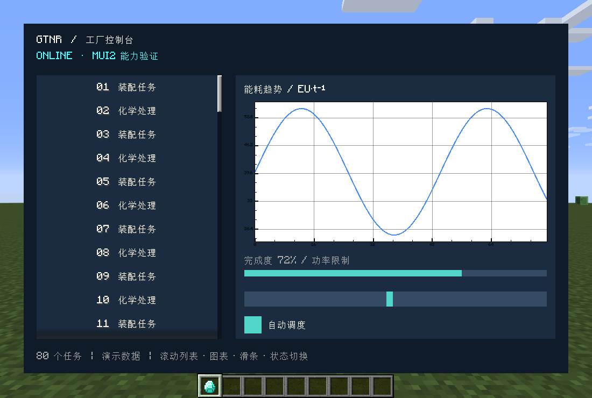
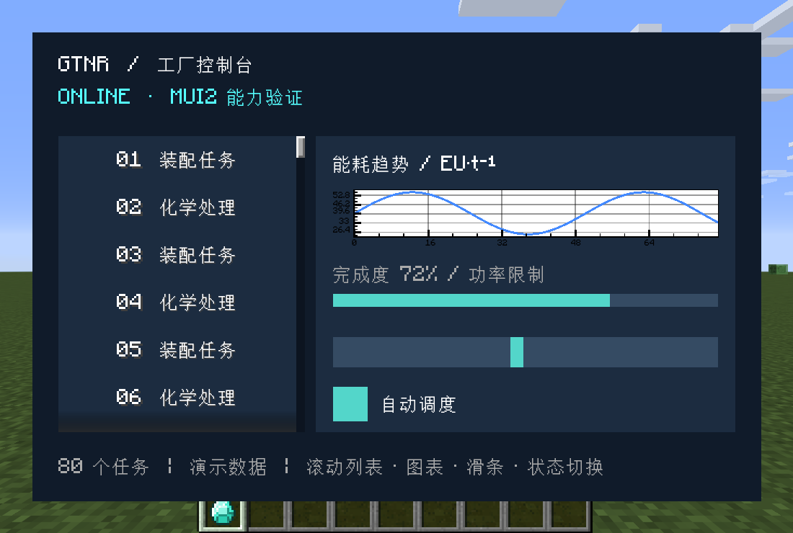
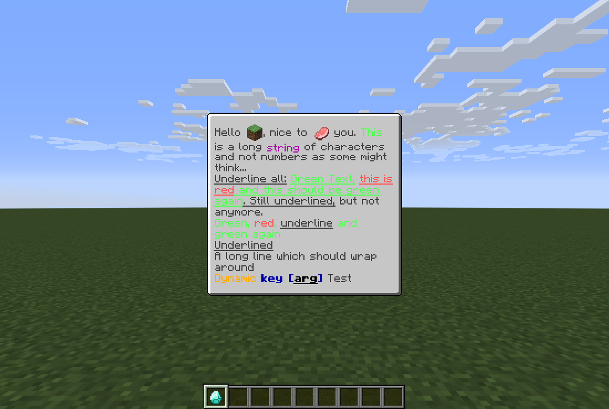
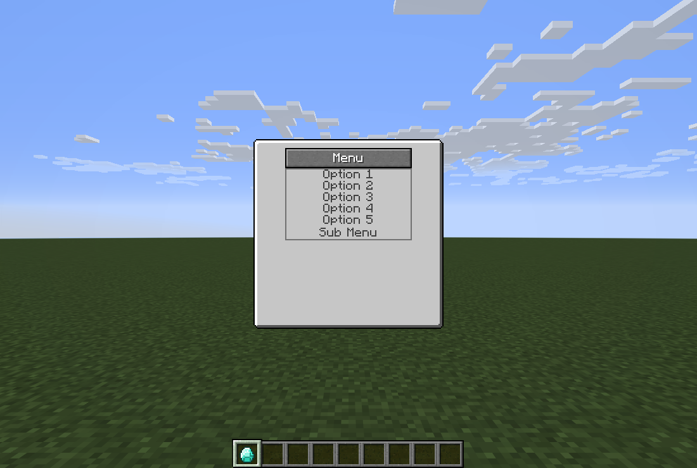
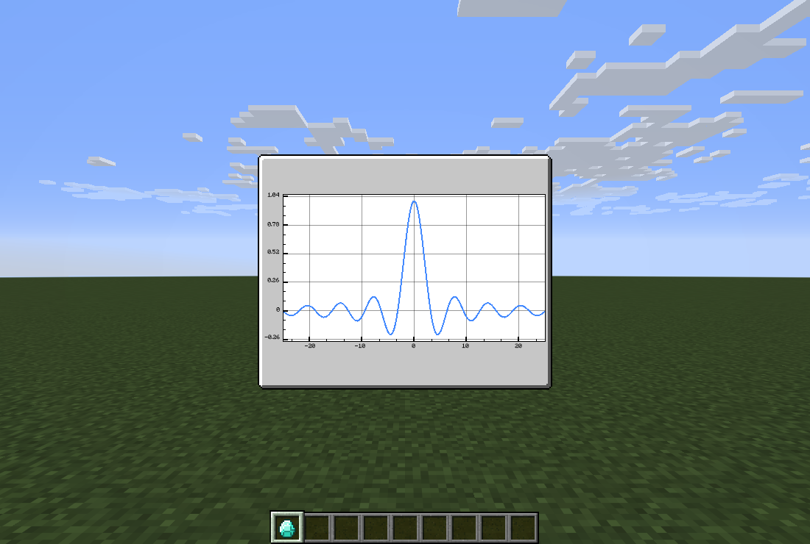
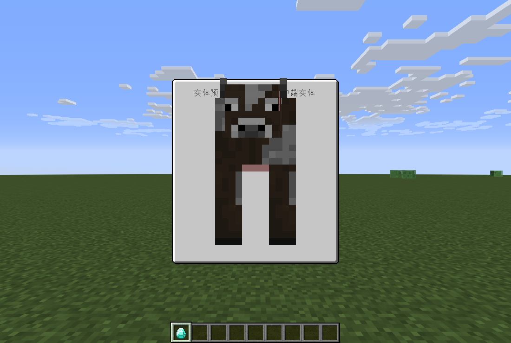
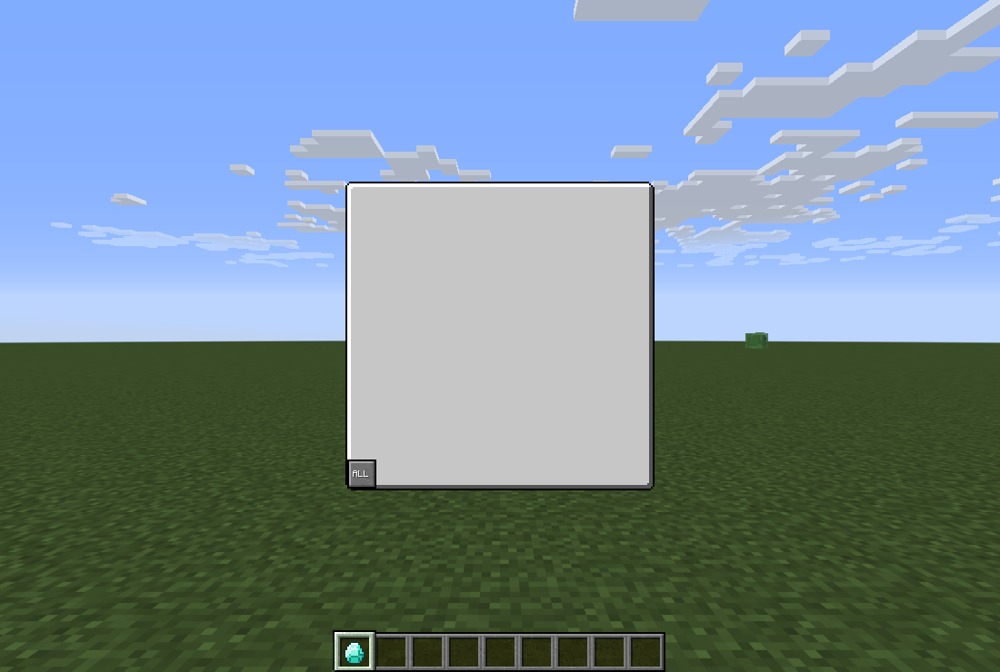

# MUI2 GUI 能力实测与 GTNR 开发指南

验证日期：2026-11-02。对象：本项目解析并运行的 **ModularUI2 2.3.94-1.7.10**，Minecraft 1.7.10 / Forge，GTNH 依赖清单 2.9.0，Java 21.0.11。这是项目开发测试端，不是未经修改的完整 GTNH 整合包安装。

MUI2 足以支持本项目的复杂机器控制台：可搜索列表、分页、嵌套弹窗、参数编辑、动态图表、富文本说明、物品与流体槽，以及服务端状态同步。视觉上可以使用完整纹理，也可以用颜色、图形、布局和组件组合出自定义风格，不必把界面限制为固定的灰色 176×166 面板。

本次遍历 **16 个官方示例入口**：15 个成功构造并打开，1 个实体示例构造失败；成功打开的结构预览中仍有空白画面。另完成排序、三档缩放控制台、实体替代路径、集成服务端同步与分页测试，保留 **33 张截图**。这些结果不是“全功能无缺陷通过”。

它提供的是 UI 框架。生产任务模型、关系图布局、海量数据分页、操作权限、事务和持久化仍由 GTNR 实现。“充分发挥”应当是复用它的布局、事件、同步、裁剪和渲染扩展点，同时明确这些边界。

## 先看实物

下图来自游戏帧缓冲截图，不是网页或效果图。示例控制台使用 80 行任务、折线图、滑条和状态切换；其中数据为演示数据，并未连接真实机器。





官方富文本、菜单和图表展示：







## 本次怎样验证

本机测试代码为 `src/test/java/com/xyp/gtneverreset/qa/Mui2CapabilitiesChecks.java`，启动配置为 `src/test/resources/mui2-capabilities-qa.init.gradle`。测试模组仅进入本次启动的测试 classpath，不进入 GTNR 正式 JAR。

- 使用 `build/mui2-capabilities-qa/run` 独立实例和新建的超平坦存档，不修改正常游戏实例。
- Windows 辅助进程只匹配本项目且带 `-Dgtnr.mui2Capabilities.qa=true` 的 Java 进程，设置透明、点击穿透、无任务栏按钮、非激活窗口；实例音量为零。
- 游戏内 Forge tick 驱动流程；钻石入口通过 `PlayerInteractEvent.RIGHT_CLICK_AIR` 触发，其余交互通过控件事件或公开 API 驱动。未使用前台鼠标、键盘或电脑操控。
- 遍历 `TestGuis` 中全部公开静态、无参数、返回 `ModularPanel` 的示例方法；额外打开排序列表、项目控制台和同步测试方块。
- 从游戏帧缓冲保存 1100×740 PNG；逐项记录构造、布局、交互和同步断言。

**证据等级：**“运行”表示已在本次客户端打开并检查截图；“交互”表示另有状态断言；“源码”表示核对了当前版本实现，未完成该功能的专门运行验证。构造成功不等于画面正确，`SchemaWidget` 就是本次反例。

本次不是物理输入端到端测试，不证明鼠标命中区域、IME 输入过程、所有键盘快捷键均正确；不是独立专用服务器或高延迟多人测试；不包含长期压力测试、NEI 拖放全流程、OpenGL 诊断页、世界内全息屏测试。

## 能力与项目用法

| 能力 | 当前版本入口 | 本次证据 | 适合 GTNR 的场景与边界 |
| --- | --- | --- | --- |
| 相对尺寸、锚点、自适应布局 | `widthRel`、`heightRel`、`left/right/top/bottom`、`coverChildren`、`expanded` | 运行；控制台三档缩放及边界断言 | 终端左右分栏、状态区、固定底栏；需定义最小可用尺寸 |
| 横纵流、换行、网格 | `Flow.row/column`、`wrap`、`Grid` | `WrappedFlow`、`AspectRatio`、`ToggleGridList` 运行 | 按钮组、卡片、筛选条件；用布局器减少手写坐标 |
| 滚动列表和过滤 | `ListWidget`、`collapseDisabledChild`、`setEnabledIf` | 交互：中文搜索与 80 行滚动 | 物种、网络节点、配方、任务；普通列表不是虚拟列表 |
| 状态切换与互斥选择 | `ToggleButton`、`CycleButtonWidget`、`valueWrapped` | 交互：本地状态切换；同步组另测 | 运行模式、过滤策略、工作等级；状态合法性由服务端检查 |
| 单行文字、数字、表达式 | `TextFieldWidget`、`numbersLong/Double`、`usingScrollStep` | 交互：中文值提交、99999 限制到 1000 | 数量、速率、阈值；客户端限制不能代替服务端限制 |
| 多行编辑器 | `TextEditorWidget` | 源码 | 简单多行编辑；不是完整 Lua IDE，语法和脚本权限仍属项目 |
| 滑条与步进 | `SliderWidget.bounds`、`stopper`、`scrollValues` | 交互：设置 75、控件状态断言 | 百分比、视觉缩放、低精度参数；精确大数配合文本框 |
| 下拉选择、菜单、子菜单 | `DropdownWidget`、`ContextMenuButton` | 菜单点击展开断言；下拉入口运行 | 模式、排序、二级操作；本次未断言每个下拉选项 |
| 多页与标签 | `PagedWidget`、`PageButton` | 原生测试方块分页检查 | 概览、任务、配置、诊断；页面切换不应重新扫描世界 |
| 可排序列表 | `SortableListWidget` | 排序页运行，`moveTo(0,1)` 顺序断言 | 队列优先级、规则顺序；未用物理拖拽验证命中路径 |
| 弹窗与面板堆叠 | `IPanelHandler`、`Dialog`、`syncedPanel` | 源码；原生测试方块提供入口 | 数量编辑、确认、详情；需区分本地面板和同步面板 |
| 富文本和富提示 | `RichTextWidget`、`RichTooltip`、`IKey` | 运行 | 彩色文本、内嵌物品图标、换行、悬停说明；点击动作需绑定 |
| 动画与视图变换 | `Animator`、`TransformWidget`、`Expandable` | 动画页前后截图、视图变换页运行 | 抽屉、折叠、缩放、提示反馈；不要让动画决定业务状态 |
| 进度与动态显示 | `ProgressWidget`、动态 value | 机器示例、动画运行 | 箭头、环形等纹理进度；选合适宽高，不能任意拉伸箭头 |
| 折线图 | `GraphDrawable`、`Plot`、`GraphAxis` | 官方和控制台曲线运行 | EU/t、产量、库存历史；历史采样与降采样自行实现 |
| 物品与流体交互 | `ItemSlot`、`FluidSlot`、`SlotGroupWidget`、对应 sync handler | 原生测试方块展示；源码核对 | 真正转移资源必须使用同步槽；显示图标不是库存槽 |
| 基础值、列表和动态控件同步 | `*SyncValue`、`GenericListSyncHandler`、`DynamicSyncHandler` | 基础值往返专门验证；集合/动态结构核对源码 | 小状态用 value，结构变化用快照/动态结构；避免全量高频传输 |
| 主题与自定义绘制 | `ThemeBuilder`、JSON theme、`Rectangle`、`IDrawable`、`UITexture` | 自定义颜色控制台运行；JSON 核对源码 | 建立 GTNR 视觉体系；让共享主题承担共同样式 |
| 实体预览 | `EntityDisplayWidget`、`GuiDraw.drawEntity` | 官方实体构造示例失败；直接构造实体方案单独验证 | 需要可靠实体来源，不应直接照抄 `FakeEntity.create` |
| 3D 方块结构预览 | `SchemaWidget`、`ArraySchema`、`BaseSchemaRenderer` | 窗口运行但画面为空 | 当前组合不宜直接作为生产级结构预览方案 |
| NEI 排除区域与幽灵槽 | `excludeAreaInRecipeViewer`、`RecipeViewerGhostIngredientSlot` | 源码及项目已有调用 | 弹窗不被 NEI 盖住、拖入过滤条件；仍需场景专测 |
| 世界内全息 UI | `holoui` | 源码；测试入口留有修复 TODO | 本次不作可直接交付承诺 |

## 实测中应记住的问题

### 原版实体示例构造失败

`TestGuis.buildSpriteAndEntityUI()` 调用 `FakeEntity.create(EntityDragon.class)`。`FakeEntity` 使用 Forge 的模组实体注册查询，结果为 `null`，随后在 `entry.getEntityClass()` 处空指针。

这证明该示例路径在当前版本不能直接使用，不证明 MUI2 无法渲染实体。替代验证直接在客户端构造 `EntityCow`，交给 `EntityDisplayWidget`，绕过该注册查询。早期试验使用已有玩家实体时可以画出玩家，但模型偏到面板下方，说明实体来源可用也不等于预览定位正确。生产中应考虑世界为空、实体类型的渲染偏移、生命周期、动画和第三方实体渲染兼容性。



牛模型虽然成功显示，头部仍越出预留控件区域并遮挡标题，因此此截图仅证明渲染路径可用，不是合格的最终预览布局。投入项目时需要额外留白、缩放和裁剪，再做逐实体检查。

### 结构示例打开但没有结构



官方 `buildWorldSchemaUI()` 提供金块、绿宝石块、钻石块、信标的 `ArraySchema`。截图中未出现这些方块。`SchemaWidget` 本身标有 `@ApiStatus.Experimental`，类说明提及 framebuffer 问题。本次观测与这一说明一致，但未隔离 Angelica、显卡驱动或其它渲染模组，不能把全部原因归给某个模组。

GTNR 的结构预览应先选择已验证的项目/GTNH 渲染路径，或把 MUI2 当作外壳嵌入专用渲染控件，单独验证深度、framebuffer 和 GL 状态恢复。二维配方路线不需要为此引入 3D 渲染。

### 数值同步默认不会允许客户端写服务端

当前 `SyncHandler` 的 `allowC2S` 默认关闭。原生 `TestTile` 的 `cycle_state` 虽有 getter/setter，仍未显式开启 C2S。**有 setter 不等于允许客户端修改。**

往返测试会先记录原始标志，再仅在该测试方块的客户端和服务端同步处理器上开启 `.allowC2S()`。之后由客户端 ToggleButton 事件发出变更，服务端断言 `cycleState == 1`，再由服务端改为 2，客户端断言第三个按钮被选中。这个测试调整不修改依赖 JAR，也不能描述为“原版 TestTile 无需调整就能双向同步”。

正式项目只给需要输入的字段开放 C2S，并在服务端验证范围、权限和状态。只读进度、产量、库存统计继续保持 S2C。

### 列表可滚动，不意味着可以无成本装下全部数据

官方搜索页一次创建 5,730 行，共 17,194 个控件。搜索“钻石”后显示 25 行，但控件树仍保留全部条目。这是“全量创建 + 禁用不匹配项”的实现，不是只创建可见行的虚拟化。

本次每页记录的 `elapsedMs` 包含构造、等待渲染、截图和测试操作，且帧数固定；不能将它当作单帧耗时或性能基准。大列表应先过滤数据，再分页/限制渲染条目，缓存物品名称与图标，不在每帧做注册表遍历、世界扫描和 NBT 深复制。

### 面板能放进屏幕，不代表内部布局合格

控制台曾出现小缩放视口下图表与进度项相挤，截图检查后改为给底部控制项保留空间。缩放 3 的图表高度仍明显受限，适合查看趋势；需要读细节时应增加独立详情页或切换紧凑布局。还应检查长中文、英文、数字、工具提示和弹窗。尺寸断言只能覆盖边界，视觉检查仍不可省略。

## 在 GTNR 中怎样组织界面

遵守仓库 `AGENTS.md`。MUI2 不改变代码的职责归属：

| 内容 | 归属 |
| --- | --- |
| GT 多方块、仓室、小机器的 MUI2 GUI | `common.gui.modularui.multiblock`、`hatch`、`singleblock` |
| 普通方块、物品、覆盖板、AE 部件 GUI | `common.gui`，复杂领域可细分 |
| 机器 UI 入口、业务操作和成型规则 | 控制器/机器；复杂状态和算法进入所属领域 |
| 只服务一个界面的按钮、预览面板、同步辅助类型 | 该 GUI 的内部类型和私有方法 |
| 独立客户端屏幕、鼠标/键盘、渲染 | `client.gui.<领域>` 或对应客户端领域，保留侧别隔离 |
| 跨 GUI 复用、确有独立职责的控件 | 按实际职责独立文件；通用且不依赖 GTNR/GT 的实现再考虑 GTNRLib |

对现有 GT 机器优先沿用已有 GUI 基类和 UI 创建入口。`ClientGUI.open` 适合纯客户端预览、编辑器和帮助页；真实机器库存/操作沿用 GT 接入或 `GuiFactories` 的同步路径。不要为了展示效果改掉机器容器模型。

项目中 `LargeCropBreederGui` 和 `LargeBeeBreederGui` 已包含独立 GUI 类、同步值和交互处理器，可作为本地接入位置的参考。本次没有重构这些界面；它们同时存在其它开发中的改动。

## 写一个复杂 GUI 的推荐流程

### 1. 先定义信息和操作，再选控件

把需求写成“玩家要看什么、改什么、结果由谁确认”。例如育种机：目标物种、候选亲本、成功率、消耗、缺失条件、路线预览、应用配置。概览保留当前最重要的状态，高级参数放配置页，详细条件放可定位的列表/提示。

常见组合：

| GUI 类型 | 推荐组合 |
| --- | --- |
| 普通机器 | 固定基本面板 + 输入/输出槽 + 进度 + 少量模式按钮 |
| 多方块控制台 | 概览/任务/配置标签页 + 实时值 + 操作反馈 |
| 无线网络终端 | 搜索栏 + 分页节点列表 + 右侧详情 + 权限控制 |
| 配方/育种规划 | 可搜索候选 + 原料/产物图标 + 自定义二维路线画布 |
| 规则编辑器 | 可排序列表 + 类型下拉 + 数值字段 + 保存/取消 |
| 诊断面板 | 最近错误 + 统计曲线 + 明确的数据时间范围 |

### 2. 将布局与数据规模一起设计

优先 `Flow`、`Grid`、相对尺寸和锚点。机器槽位矩阵适合明确的逻辑像素；可变内容放 `ListWidget`。窗口底部的应用/关闭操作应固定，长说明不要挤走主要操作。

相对尺寸不会自动实现网页式断点布局。小屏需要自行选择隐藏次要信息、改为分页、纵向排列或限定最小尺寸。也不要让 `coverChildren` 的父尺寸与子项 `widthRel(1)` 构成无法求解的尺寸依赖；给其中一层明确约束。

### 3. 明确本地值、草稿和权威状态

- 搜索词、当前标签、折叠状态、视口缩放：优先本地 `StringValue`/`IntValue`/`BoolValue`。
- 进度、EU/t、库存、当前机器模式：服务端 getter 的 `*SyncValue`。
- 输入草稿：本地或明确允许 C2S 的受限字段；通过“应用”动作提交给机器。
- 资源移动、任务创建、消耗和权限：服务端业务方法。GUI 只负责展示与提交意图。

数值处理器的典型模式（示意，`machine` 方法由所属机器实现）：

```java
IntSyncValue limit = new IntSyncValue(
    machine::getLimit,
    value -> machine.setLimit(Math.max(1, Math.min(64, value))))
    .allowC2S();
syncManager.syncValue("limit", limit);

panel.child(new TextFieldWidget()
    .numbersLong(1, 64)
    .syncHandler("limit"));
```

需要玩家权限、跨字段原子提交或昂贵计算时，用受控交互动作调用机器业务方法，而不是给多个 setter 随意写权限。注册同步处理器/构建面板时不要提前调用 `PanelSyncManager.getPlayer()`；在容器绑定后的服务端交互中获取玩家。

```java
syncManager.syncValue("apply", new InteractionSyncHandler()
    .setOnMousePressed(mouse -> {
        if (mouse.isClient() || mouse.mouseButton != 0) return;
        machine.applyValidatedDraft(syncManager.getPlayer());
    }));
panel.child(new ButtonWidget<>().syncHandler("apply"));
```

这里 `applyValidatedDraft` 是项目应实现的业务方法，不是 MUI2 API。同步 ID 在两端必须一致；不要根据客户端本地筛选结果注册不同的同步树。

### 4. 用内置控件解决通用交互

需要菜单先看 `DropdownWidget`/`ContextMenuButton`；分页先看 `PagedWidget`；排序先看 `SortableListWidget`；动态同步内容先看 `DynamicSyncHandler`/`DynamicLinkedSyncHandler`。不要再手工实现第二套焦点、滚动、按钮选择或窗口堆叠机制。

用于显示的 `ItemDrawable`、`ItemDisplayWidget`、`FluidDisplayWidget` 不等于能实际转移物品/流体的槽位。真实槽位使用相应 slot 与 sync handler，注册 slot group 和玩家背包，再验证点击、Shift 点击、拖放与关闭界面时的行为。

### 5. 复杂图形仍可以融入 MUI2

二维关系图、时间轴、节点网络和路线编辑器适合专用 Widget：复用 MUI2 的区域、裁剪、事件与变换，自己维护节点坐标、连线、命中检测、缩放/平移和业务选择。`GraphDrawable` 是数值曲线工具，不是任意有向图布局引擎。

选择扩展层级：

| 需求 | 方式 |
| --- | --- |
| 背景、线条、徽标、只读图形 | `IDrawable` / `Rectangle` / `UITexture` |
| 具有点击、拖拽、滚轮的画布 | 专用 Widget + `Interactable` |
| 需要裁剪和坐标变换的复杂视图 | 结合 viewport/transform API，成对恢复变换与 stencil |
| 有服务端行为的自定义控件 | 视图 + 已注册 SyncHandler；业务仍在机器/领域实现 |

手写绘制时检查 GL 颜色、纹理、深度、blend、scissor/stencil 的恢复。不能以某一帧画对了为结束标准，要在关闭/重新打开、叠加弹窗和切回其它 GUI 后验证。

### 6. 建立一致视觉，而不是每页换风格

建议 GTNR 约定背景层级、主色、文字/次要文字色、成功/警告/错误状态、按钮高度、间距和图标尺寸。颜色不应是唯一状态标识。`ThemeBuilder` 与主题 JSON 可承担复用样式；本次控制台为直观验证使用局部 `Rectangle`，不是正式主题系统。

当前 `ThemeManager` 查找各资源域的 `themes.json`，主题映射再加载 `themes/<name>.json`；可使用 `useTheme` 或对应 UI 设置选主题。采用正式主题时从本版本内置资源验证字段，避免照搬其它 Minecraft 版本教程中的 JSON。

动态文本尽量缓存格式化结果，变化时更新。正式文案使用邻近 `#tr` 的语言键；本次仅测试源中的展示文字直接写中英文，不应照搬到生产代码。

## 性能和正确性的交付标准

以下是项目实现建议，不是本次已测出的硬上限：

1. 列表先查询/过滤数据，再创建当前页。不要让一个小窗口永久持有几万条 Widget。
2. 高频曲线使用固定长度历史缓冲；只发送需要显示的采样，按时间或数据版本更新。反复 `plot()` 会追加曲线，更新既有数据应管理 `Plot` 和重绘。
3. 网络快照只含 GUI 所需数据。复杂图布局缓存到数据版本变化时重建，缩放/平移只调整视图。
4. UI 每帧不扫世界、不解析配置、不读磁盘、不做全量注册表扫描。
5. 操作应给出成功/失败/等待反馈；服务端可能拒绝请求，不能把客户端的临时选中当成真实结果。
6. 弹窗关闭、机器失效、切维度、退出世界后释放监听、会话和临时资源，避免残留旧机器引用。
7. 验证最小窗口、常用缩放、长中文/英文、空列表、超大数、禁用操作、重复打开、NEI 相邻区域。
8. 发布重要同步界面前补专用服务器、两个玩家和网络延迟场景；本次集成服务端往返不能替代这些测试。

## 后续写 GUI 时的验收清单

- [ ] 明确信息层级、状态来源和主要操作。
- [ ] 同类职责落在项目约定目录，专用小类型优先放所属 GUI 内部。
- [ ] 优先复用 MUI2 的布局/滚动/分页/菜单/同步能力。
- [ ] 生产数据仅服务端变更，C2S 显式开放且服务端再次校验。
- [ ] 动态内容有分页、缓存或规模限制；没有每帧全量扫描。
- [ ] 自定义画布与业务算法分开，图形状态正确恢复。
- [ ] 三档 GUI 缩放截图、实际状态断言和重新打开验证完成。
- [ ] `spotlessCheck`、`compileJava`，资源变更时 `processResources` 通过。

## 复现与证据

本机具备上述测试文件时，在项目根目录运行：

```powershell
.\gradlew.bat -I src/test/resources/mui2-capabilities-qa.init.gradle :runClient17 --no-configuration-cache
```

结果位于 `build/mui2-capabilities-qa/run/report.txt`、`result.txt`、`screenshots/`，窗口辅助进程日志位于 `build/mui2-capabilities-qa/window-helper.log`。固定保存的本次记录见 [测试记录](mui2-evidence/report.txt)、[截图索引与人工复核](mui2-evidence/gallery.md)、[环境与文件校验值](mui2-evidence/environment.txt)。

`result.txt` 的 PASS 表示探测流程和要求的交互断言完成；官方示例的构造失败另记为 `EXAMPLE_FAILURE`，不能解释为所有功能都通过。3D 空白属于截图检查发现，也不由“面板有宽高”的自动断言覆盖。

验证源码为 Gradle 缓存中的 `ModularUI2-2.3.94-1.7.10-sources.jar`。上游对应 tag 指向 `fdb5245690e6d261054acc4ebce3cbedf2d97e44`；以后升级必须按实际依赖重新验证。本指南的 API 结论优先来自该源码和运行结果，不套用其它版本的文档。

上游入口：[ModularUI2 仓库](https://github.com/GTNewHorizons/ModularUI2)、[本次版本源码](https://github.com/GTNewHorizons/ModularUI2/tree/fdb5245690e6d261054acc4ebce3cbedf2d97e44/src/main/java/com/cleanroommc/modularui)、[官方示例](https://github.com/GTNewHorizons/ModularUI2/blob/fdb5245690e6d261054acc4ebce3cbedf2d97e44/src/main/java/com/cleanroommc/modularui/test/TestGuis.java)。本仓库保留自编测试夹具和截图，不复制整套上游实现。
