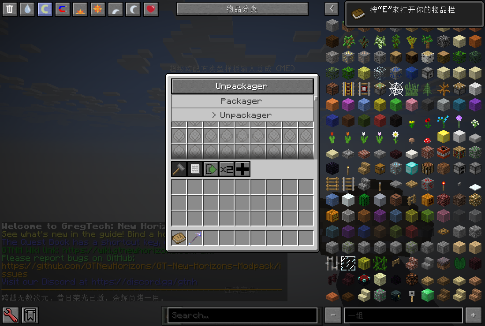

# 样板配方池与跨类型输入总成

快捷编码终端从 GT 的 NEI 配方页导入处理配方时，将该页的 `RecipeMap.unlocalizedName`
写入样板的 `gtnrPatternRecipeMap` 字段。此字段独立于“写入编程电路和模具信息”开关。
重新编辑、倍增和通配符展开保留配方池；终端修改输入或输出的物品、流体类型后，不再沿用旧配方池。
手动填写且没有导入来源的配方不猜测配方池。

“超级跨配方类型样板输入总成 (ME)”继承电路样板总成的独立缓存、虚拟电路和模具。
只有新总成的库存启用按样板选择配方池；旧总成及单方块推料的行为不变。
未携带配方池的样板按控制器当前模式加工，未知、损坏或机器不支持的配方池保留原料，不能退回其他池误加工。
相同输入输出但配方池不同的通配符展开结果拥有不同标识。

新总成顶部提供固定宽度的配方池下拉栏，选项取自所连接控制器的全部可用配方池。
它只选择 AE 接口终端中的名称，不改变加工模式；显式选择会替换已有的手动命名，选择结果随存档保存。
未连接控制器时不显示过期选项，重新连接后恢复仍有效的选择。
下拉栏直接复用 GTNRLib 的 `ScrollingDropdown`，与样板通配符界面一致，选项之间有细分隔线，
超长名称在固定栏位内横向滚动。



跨池处理使用机器的 `getAvailableRecipeMaps`、`nextMachineMode` 和 `setMachineMode`，
不维护按名称匹配的机器白名单。检查目标配方前重新运行原生参数准备，保留目标模式的电压、并行、速度、
耗电及配方校验。完成或失败后恢复原模式及处理参数。配方锁定期间不自动切换到其他模式。
电路装配线还执行目标模式的印刻和长度前置检查。

适配范围是使用 GT `ProcessingLogic` 与原生模式接口的机器，并非任意声明多个配方池的控制器。
研究站的专用研究流程、由输入电路选择内部流程的机器，以及绕过上述接口的第三方实现，
不能仅凭配方池列表接入。机器进入处理流程前执行的原有前置检查仍然生效；
例如电路装配线在当前模式下的印刻或长度要求也需要满足。

## 验证

在 Windows 开发环境运行：

```powershell
.\gradlew.bat -I src/qa/resources/circuit-pattern-qa.init.gradle :runClient17 --no-configuration-cache --console=plain
.\gradlew.bat -I src/qa/resources/cross-recipe-selector-qa.init.gradle :runClient17 --no-configuration-cache --console=plain
```

夹具使用 `build/circuit-pattern-qa/run` 下的独立游戏实例，通过游戏内事件执行断言。
启动脚本静音，并将测试窗口透明、点击穿透和隐藏任务栏；不对正常游戏实例进行操作。
结果为该目录下的 `result.txt`，通过时保存 `screenshots/circuit-pattern.png`。
`src/qa` 不进入发行包。

覆盖快捷终端编码和重新编辑、网络载荷往返、通配符展开及倍增、电路模具和单方块推料回归，
以及真实原生控制器的打包/拆包连续加工、缓冲区存档重载、错误配方池不消耗原料、配方锁定、
精密装配机结构等级校验、巨型蒸馏塔目标模式速度与耗电对照。
另遍历测试实例已注册的多模式控制器检查配方池选择和模式恢复；该遍历不是所有机器完整结构加工测试。

第二个夹具使用独立的客户端和服务端总成实例打开真实 GUI，通过控件事件选择选项并验证 C2S/S2C 同步。
覆盖候选数量、接口终端命名、保存重载、控制器更换与断开、重新打开、长文字裁剪及 GUI 缩放 1/2/3。
结果及截图位于 `build/cross-recipe-selector-qa/run`。
